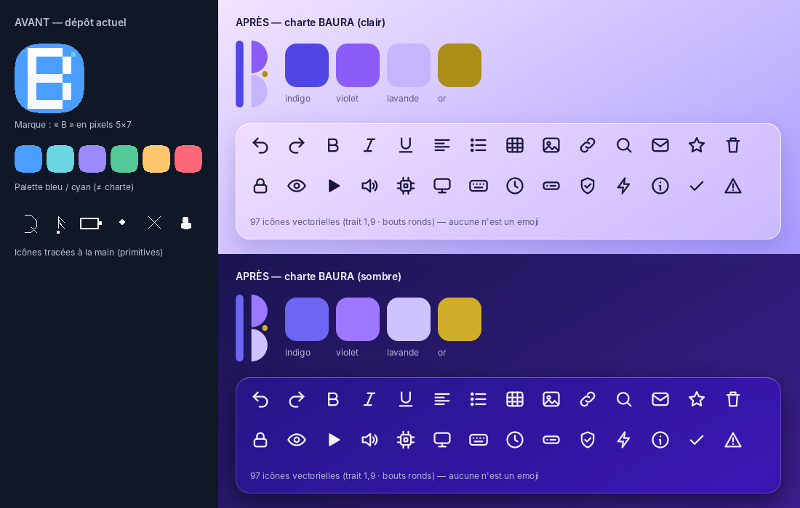

# 01 — Identité et vectoriel (charte, symbole, icônes, anti-crénelage)


*Gauche : rendu actuel du dépôt. Droite : charte BAURA (clair puis sombre) dessinée par le même `BGERenderer`.*

## Ce que ça apporte
* **Jetons de charte** `common/baura_theme_brand.h` : `LIGHT` / `DARK` (ARGB) avec les mêmes noms que le CSS (`fg`, `mut`, `glass`, `hair`, `hover`…).
* **Symbole réel** `Painter::symbol(rect, b1, b2, b3, b4)` : barre pilule `150,29 · 48×420 · rx24`, demi-disques `A101 102.5` / `A101 102`, point or `316,221 · 33×36 · rx15` (viewBox `150 29 199 420`).
* **550 icônes (97 BAURA + 453 Lucide, voir 09-ICONES) vectorielles** (24×24, trait 1,9, bouts ronds) : `Painter::icon("search", rect, couleur)`. Source unique : `common/baura-icons.js` (issu du prototype), converti en tableau C++ `common/icons_data.h` par `common/tools/gen_icons550.py` (l’ancien `tools/gen_icons.py` ne produit que les 97 icônes d’origine).
* **Anti-crénelage** : rectangles arrondis par distance signée (`fill_rrect`, `stroke_rrect`), chemins SVG (`fill_path`, `stroke_path`), dégradés à angle CSS (`Paint::linear(145, c0, c1)`).

## Comment ça s'accroche au BGE existant
`Painter` enveloppe un `BGERenderer` : il lit la taille de `renderer.framebuffer()` et écrit via `draw_pixel_alpha`. **Aucune modification de `GUI/BGE`.**
```cpp
BGERenderer r(fb); BauraVec::Painter p(r);
p.symbol({24, 24, 44, 92}, T.b1, T.b2, T.b3, T.b4);      // T = BauraBrand::LIGHT ou DARK
p.icon("search", {100, 24, 28, 28}, T.fg);
```
Intégration suggérée : remplacer `BauraBrand::draw_mark` par `Painter::symbol`, et `BGERenderer::draw_icon(name)` par `Painter::icon` (les ids du catalogue `papirus_icon_catalog` se mappent sur les noms BAURA : `system-search → search`, `window-close → x`, …).

## À savoir
* `Path::fromSVG` analyse M L H V C S Q T A Z. Pour l'OS final, pré-aplatir les icônes à la compilation (tableaux de segments) et retirer le parseur du runtime.
* Le trait est calculé par distance au polyligne (O(pixels × segments)) : suffisant pour des icônes ≤ 64 px, à mettre en cache (atlas) pour l'interface complète.
* Régénérer les icônes : `python3 01-IDENTITE-ET-VECTEUR/tools/gen_icons.py`.
