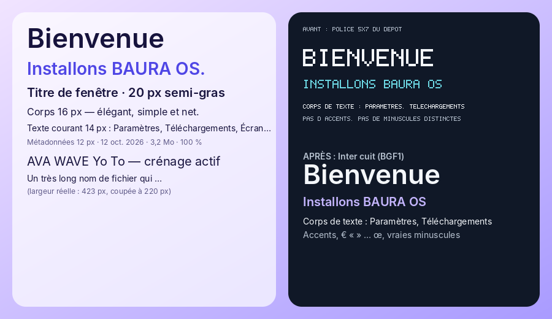

# 02 — Texte réel (Inter, accents, crénage)


*Droite : police 5×7 du dépôt (majuscules, sans accents). Gauche et bas-droite : Inter cuit, anti-crénelé, avec crénage.*

## Principe
Pas d'analyseur TTF dans l'OS. Un outil **hôte** (`tools/bake_font.py`, Pillow/FreeType) « cuit » Inter en un atlas binaire **BGF1** (≈ 500 Kio : 2 graisses × 6 tailles × 157 glyphes + 12 972 paires de crénage). L'OS ne fait que charger ce blob (initrd/fichier) et dessiner des bitmaps de couverture 8 bits.

| Élément | Détail |
|---|---|
| Graisses | Regular 400, SemiBold 600 |
| Tailles | 12, 14, 16, 20, 28, 44 px (la plus proche est choisie — pas de mise à l'échelle floue) |
| Jeu de caractères | ASCII + français (`àâäçéèêëîïôöùûüÿœæ`), `€ « » … · × ÷ − – — ‘ ’ “ ” → ← ↑ ↓ ✓ ≠ ≤ ≥ ° © ®` |
| API | `Font::load`, `measure`, `draw`, `ellipsize`, `metrics` (`common/baura_text.h`) |
| Unicode | décodage UTF-8, repli sur `?` |

```cpp
Font font; font.load(blob, len);                       // blob = contenu de inter.bgf
font.draw(painter, x, baseline, "Paramètres", 14, T.fg);
float w = font.measure("Téléchargements", 14);
std::string s = font.ellipsize(nom, 220, 14);          // « Un très long nom… »
```
Format BGF1 documenté en tête de `tools/bake_font.py`.

## Limites / suite
* Licence : **Inter est sous SIL OFL** (redistribution autorisée, garder la licence dans l'image).
* Pas de mise en forme complexe : l'**arabe (RTL, formes contextuelles)** et l'indien exigent HarfBuzz — traité au document 08.
* Positionnement des glyphes à l'entier (pas de sous-pixel) ; ajouter plus de tailles ou un atlas SDF si l'on veut l'échelle libre.
* Intégration : remplacer `BGERenderer::draw_text` (5×7) par `Font::draw` dans `ui_framework`, taskbar, login, installateur.
