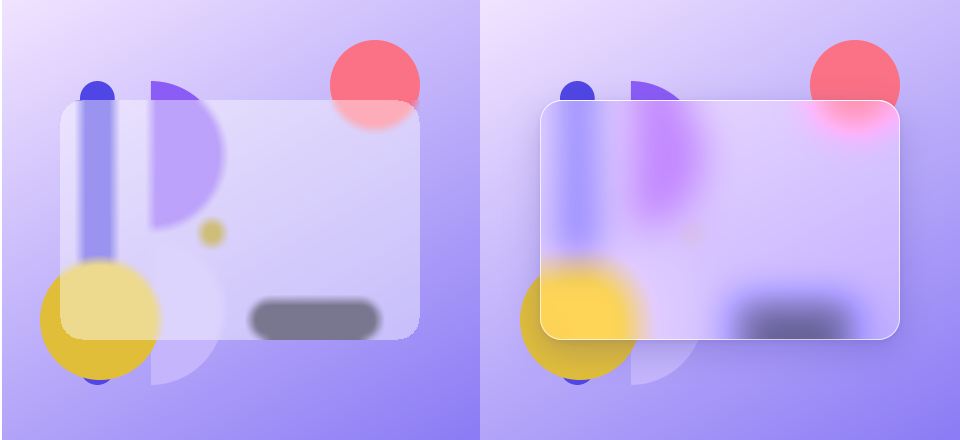

# 03 — Verre fidèle et ombres portées


*Gauche : `BGEEffects::draw_glass_panel` actuel. Droite : verre BAURA (`baura_glass.h`) sur le même fond.*

## Recette (dans cet ordre, comme le prototype)
1. `shadow(...)` ×2 — ombres `0 12 34` et `0 2 6`, **découpées hors de la forme**.
2. Flou **gaussien** (3 passes de boîte, σ = 18) de ce qui est déjà dessiné derrière.
3. **Saturation ×1,9** (matrice CSS `saturate()`).
4. Teinte `glass`, bordure 1 px `glass-line`, **reflet haut** blanc dégradé (.75 clair / .20 sombre).

| | Actuel (`effects_engine`) | Nouveau (`baura_glass.h`) |
|---|---|---|
| Flou | boîte, 1 passe, rayon ≤ 32 | gaussien (3 passes), σ libre |
| Saturation | non | oui |
| Bordure / reflet | non | oui |
| Ombre portée | non | oui |
| Coins | crénelés | anti-crénelés |
| Mode « transparence réduite » | — | `GlassStyle::opaque_fallback` |

```cpp
GlassStyle g; g.tint = T.glass; g.line = T.glass_line; g.highlight = T.highlight;
shadow(p, r, 22, 12, 34, T.shadow1); shadow(p, r, 22, 2, 6, T.shadow2);
glass(p, r, 22, g);          // APRÈS avoir dessiné fond et fenêtres situés derrière
```

## Performance mesurée
360×240 : **≈ 16 ms** (hôte, 1 cœur, flottants). Pour du plein écran à 60 i/s :
* flouter à **¼ de résolution** puis agrandir ; mettre en **cache** tant que le fond ne change pas ;
* limiter aux **rectangles sales** ; version entière/SIMD du flou ;
* un backend GPU (plus tard) fait ce flou en 2 passes séparables.
Le plafond de 4 194 304 pixels du dépôt reste une bonne garde : à reprendre dans `glass()`.
