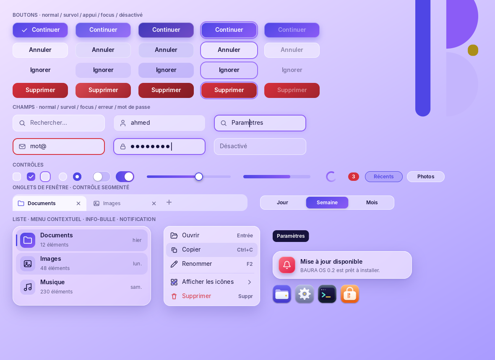
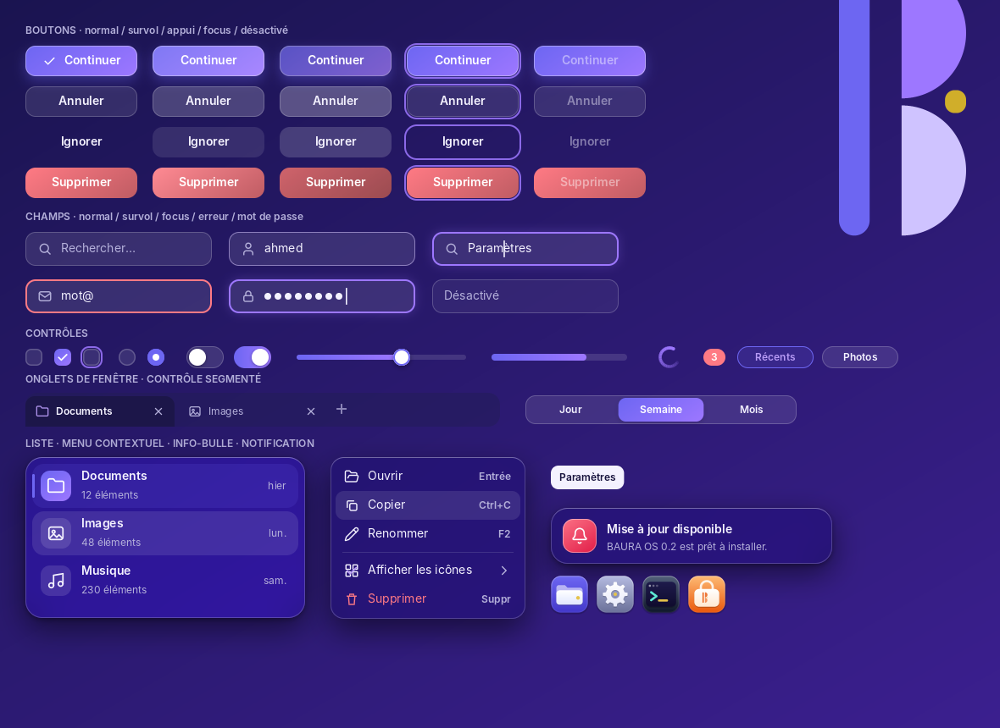

# 04 — Composants (champ de saisie, listes, onglets, interrupteur, menus…)

| Code | Rôle | Rendu |
|---|---|---|
| `../common/baura_ui.h` | kit de composants en **dessin pur** : chaque fonction dessine à partir des jetons de la charte et **retourne sa zone cliquable** | `render/composants_light.png`, `render/composants_dark.png` |
| `../common/baura_textedit.h` | modèle d'édition de texte UTF-8 (curseur, sélection, mots, presse-papiers) — logique sans dessin | — |
| `code/test_components.cpp` | génère les deux planches | |
| `code/test_textedit.cpp` | vérifie le modèle d'édition (UTF-8, mots, sélection, limite) | `./test_textedit` |

## 1. Spécification (dimensions = contrat de design)
| Composant | Dimensions | États dessinés | Notes |
|---|---|---|---|
| Bouton | h 36, rayon 12, texte 14/600 | normal, survol, appui, focus, désactivé | 4 types : primaire (dégradé b1→b2), secondaire, discret, danger ; icône optionnelle 18 px |
| Bouton icône | 34×32, rayon 12 | normal, survol, sélectionné, désactivé | |
| Champ de saisie | h 40, rayon 12 | normal, survol, focus (anneau b1 2 px + curseur), erreur, désactivé | icône à gauche, mot de passe masqué, texte indicatif |
| Case à cocher | 20, rayon 7 | cochée/non, focus | |
| Radio | 20 | choisie/non | |
| Interrupteur | 44×26 | on/off, progression d'animation `t` | poignée 20 px avec ombre |
| Curseur | piste 6, poignée 20 | — | |
| Progression | 8 | valeur 0..1 | dégradé b1→b2 ; `spinner()` pour l'indéterminé (arc 270°) |
| Pastille / puce | h 20 / h 26 | active/inactive | |
| Onglets de fenêtre | h 36, rayon 11 | actif/inactif, icône | rognés à la barre |
| Contrôle segmenté | h 34 | un élément actif | |
| Ligne de liste | h 52 | normal, survol, sélection (filet b1 de 3 px) | titre 14/600, sous-titre 12, valeur à droite |
| Menu contextuel | verre fort, rayon 16, entrées 34 | survol, désactivé, coché, sous-menu, danger | séparateurs 9 px, raccourcis à droite |
| Info-bulle | h 28, rayon 9 | — | fond = couleur du texte (inversée) |
| Barre de défilement | 4 px | — | |
| Panneau de verre | rayon 20–28 | normal / fort | ombre + flou + saturation (voir `03`) |
| Tuile d'application | rayon = 32 % du côté | — | dégradé 145° + bord blanc + ombre |
| Cadre de fenêtre | barre 46, rayon 22, boutons 32×24 | actif, inactif, administrateur | |
| Notification | 332 px, rayon 20 | — | |

## 2. Principe d'architecture : dessin pur + état externe
`Ui{Painter&, Font&, Tokens&, rtl}` est passé partout. Un composant **ne garde aucun état** : l'appelant fournit `State` (normal/survol/appui/focus…), la valeur et le texte. Avantages : rendu déterministe (tests d'image), pas d'allocation, facile à porter sur `BGEUIFramework`. La logique d'interaction (survol, focus, clic) vit dans un petit contrôleur par fenêtre qui :
1. reçoit les événements du pilote d'entrée (`BauraPs2Event`),
2. compare le point à la zone cliquable **retournée** par la fonction de dessin (jamais à des constantes dupliquées),
3. met à jour `State` et demande un nouveau rendu.

Champ de saisie = `TextEdit` (logique) + `input(u, rect, text, placeholder, state, icon, password, caret)` (dessin) ; la sélection se dessine par-dessus le texte avec `u.a(T.b1, .25f)`.

## 3. Plan de migration vers le dépôt
| Étape | Action |
|---|---|
| 1 | copier `baura_ui.h`, `baura_text.h`, `baura_vector.h`, `baura_glass.h`, `baura_theme_brand.h`, `baura_textedit.h` dans `GUI/UI_FRAMEWORK/` (en-têtes uniquement) |
| 2 | ajouter `test_components` et `test_textedit` à `make test-gui` (fichiers .cpp du Makefile) |
| 3 | remplacer progressivement les boutons/champs de `baura_ui_toolkit.cpp` par les fonctions du kit ; **garder** les signatures publiques de `BAURA_UI_FRAMEWORK.h` |
| 4 | brancher la logique d'événements (survol/focus/clic) dans `BauraDesktop::process_event` |

## 4. Limites
- Aucun **défilement** réel (liste virtualisée) ni **sélection multiple** : à faire avec `scrollbar()` + un modèle de liste.
- Pas de composant **date/heure**, **tableau triable**, **arbre**, **menu déroulant** (le menu contextuel existe ; le champ « select » est une composition champ + menu).
- Composants non accessibles tant qu'ils ne déclarent pas leur nœud (voir `08`).
- Le texte multi-ligne (`TextEdit` est mono-ligne pour l'instant) et le glisser-déposer ne sont pas couverts.
