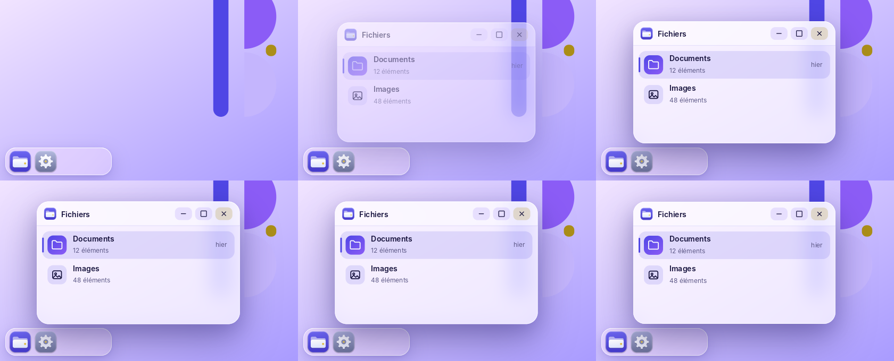
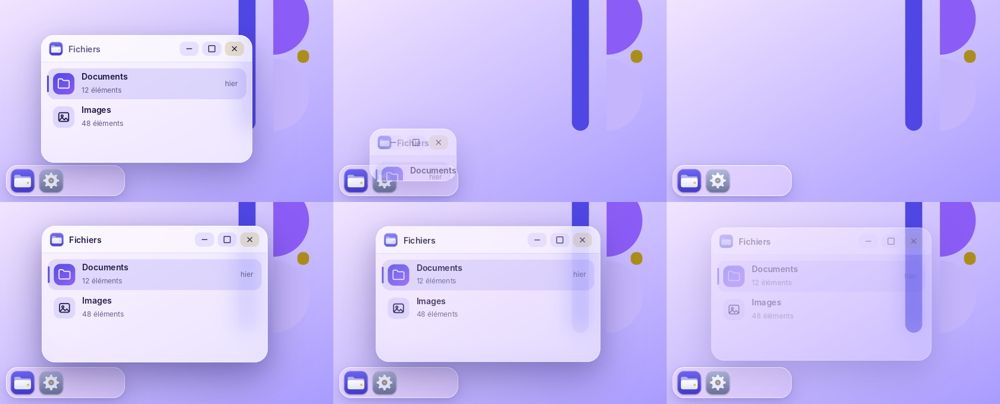
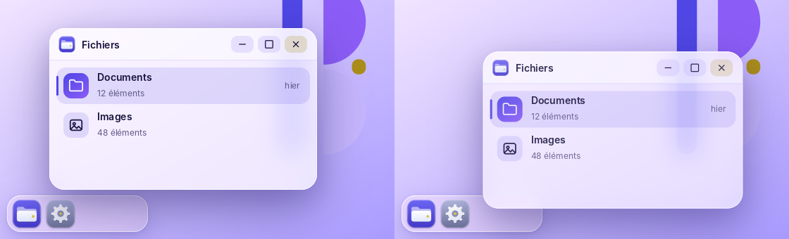
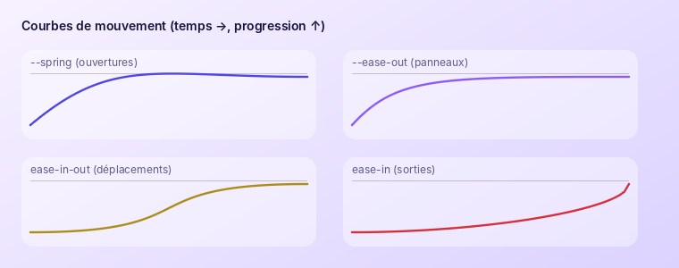

# 05 — Mouvement branché sur `BGEWindowManager`

| Code | Rôle | Rendu |
|---|---|---|
| `../common/baura_motion.h` | courbes cubic-bezier identiques au CSS (`SPRING`, `EASE_OUT`, `EASE_IN_OUT`, `EASE_IN`), `Spring` physique, `Tween`, `Animator` (+ `reduce_motion`) | `render/courbes.png` |
| `../common/baura_wm_motion.h` | **compositeur animé** qui *observe* `BGEWindowManager` (ouverture, fermeture, réduction vers la barre, restauration, agrandissement, déplacement) | `render/ouverture.png`, `render/fermeture-reduction.png`, `render/deplacement.png` |
| `patches/0001-window-manager-expose-state.patch` | **seul** changement optionnel du dépôt : 2 getters en lecture seule dans `window_manager.h` | — |
| `code/test_motion.cpp` | génère les planches et vérifie les invariants | `./test_motion` → « mouvement : invariants OK » |

## 1. Séquences
| Action | Durée | Courbe | Effet |
|---|---|---|---|
| Ouverture | 300 ms | `SPRING` | 94 → 100 % avec dépassement, fondu 0 → 1 sur le premier tiers |
| Fermeture | 180 ms | `EASE_IN` | 100 → 96 %, fondu → 0 puis **fenêtre fantôme** supprimée |
| Réduction | 260 ms | `EASE_IN_OUT` | glisse vers l'**icône de la barre** en rétrécissant à 12 %, se fond |
| Restauration | 260 ms | `EASE_IN_OUT` (inverse) | depuis la barre vers sa position |
| Agrandissement | 280 ms | `EASE_IN_OUT` | rectangle interpolé |
| Déplacement | continu | ressorts | tenue = 97 % de taille, 88 % d'opacité ; relâchée = retour amorti |
| `reduce_motion` | 0 ms | — | état final immédiat |






## 2. Comment ça se branche (observation, pas remplacement)
`BGEWindowManager` garde l'état réel (liste, z-order, focus, clic). Avant chaque rendu :
```cpp
wm_motion.update(wm, dt);            // compare windows_view() à l'image précédente : fenêtre nouvelle => Opening,
                                     // disparue => Closing (fantôme), minimized passe à vrai => Minimizing, etc.
wm_motion.draw(u, draw_content);     // dessine chaque fenêtre selon son Visual (échelle/opacité/rect), fantômes compris
```
Les rectangles de réduction viennent de `dock_rect(id)` (icône de la barre flottante) et le style (icône, couleurs) de `style(id, visual)`.

## 3. Le patch (optionnel, 4 lignes)
```
+    const std::vector<BGEWindow> &windows_view() const { return windows; }
+    uint32_t dragging() const { return dragging_id; }
```
Sans le patch, il faut dupliquer l'état des fenêtres dans le compositeur animé — déconseillé. Appliquer : `git apply 05-MOUVEMENT/patches/0001-window-manager-expose-state.patch` **dans votre copie locale** (rien n'est poussé).

## 4. Invariants vérifiés par le test
Après ouverture : mode `Idle`, échelle = 1 ± 10⁻³ · après réduction : mode `Minimized` · après fermeture : plus aucune fenêtre fantôme · pendant le déplacement : opacité < 95 % · avec `reduce_motion` : état `Idle` dès la 2ᵉ mise à jour.

## 5. Limites connues (à traiter en P5)
- Le **titre et le contenu** de la fenêtre ne sont pas mis à l'échelle pendant l'animation (le cadre l'est) : acceptable à 300 ms, à améliorer en dessinant la fenêtre dans une surface hors écran puis en la zoomant.
- Les fenêtres fantômes sont dessinées **au-dessus** des autres.
- Les constantes de **hit-test** du `BGEWindowManager` (barre 40 px, contrôles 84 px, barre des tâches 58 px) doivent passer à **46 px / 3 × 32 px / barre flottante** quand le nouveau cadre est adopté, sinon on clique à côté des boutons dessinés.
- Pas de transition de thème, de défilement inertiel ni d'animation d'icône.
- Le coût d'une fenêtre de verre animée n'est pas encore optimisé (voir P11 : cache du flou, rectangles sales).
