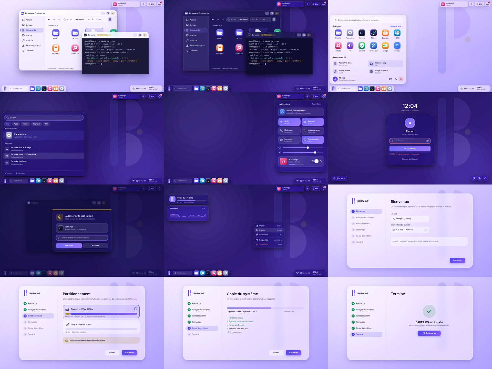
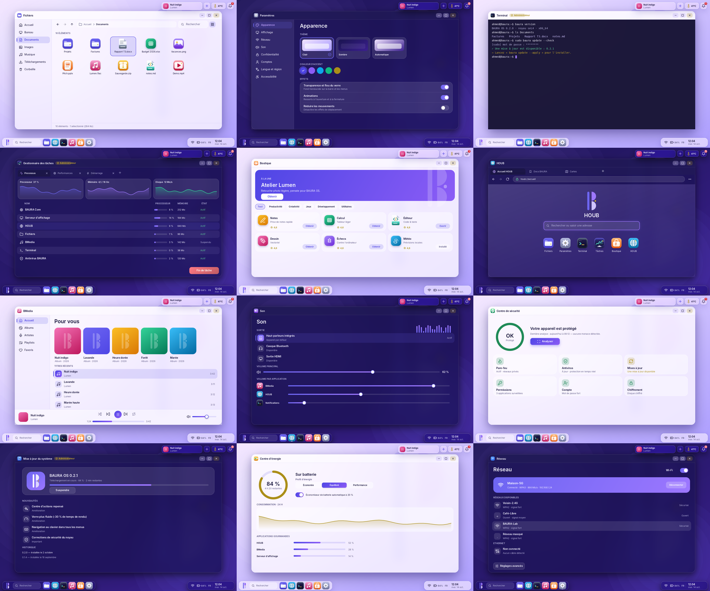

# 07 — Bureau cible (« le glow up ») et modèles d'applications

Tout ce dossier est **de la référence visuelle + du code de dessin** (C++17 sur `BGERenderer`, sans toucher `GUI/BGE`). Ce n'est pas l'interface réelle : c'est la cible vers laquelle on migre, écran par écran (voir `../10-FEUILLE-DE-ROUTE`).

| Code | Contenu |
|---|---|
| `code/baura_shell.h` | coque : fond, barre flottante, zone d'état, Démarrer, recherche, centre d'actions, connexion, UAC, bulle système |
| `code/baura_apps.h` | 12 modèles d'applications (Fichiers, Paramètres, Terminal, Tâches, Boutique, HOUB, BMedia, Son, Sécurité, Mise à jour, Énergie, Réseau) |
| `code/test_screens.cpp` | génère les 29 rendus (`render/`), clair + sombre ; vérifie qu'aucune icône n'est manquante (`-DBAURA_ICON_DEBUG`) |
| `../common/mono.bgf` | police à chasse fixe (DejaVu Sans Mono, 12/13/14) pour le Terminal |

Vues d'ensemble : `render/ecrans_planche.png` (coque + installateur) · `render/apps_planche.png` (12 applications).



## 0. Disposition du bureau : un défaut + des options
Le **défaut est la barre coupée en deux** (structure du dépôt) avec les widgets en haut à droite. Les autres formes sont des **options** (Paramètres › Bureau, `baura-prefs: layout`) :
| Disposition | Réglage | Rendu |
|---|---|---|
| **Barre coupée en deux** (défaut) | `split-dock` | `render/bureau_defaut_clair.png`, `bureau_defaut_sombre.png` |
| Pastille flottante (une seule pilule centrée) | `floating-pill` | `render/option_barre-flottante_clair.png` |
| Pleine largeur (barre collée en bas) | `full-width` | `render/option_pleine-largeur_clair.png` |
| Page de réglage | `Paramètres › Bureau` | `render/reglage_bureau_clair.png`, `reglage_bureau_sombre.png` |
Dans le code : `BauraShell::Layout{SplitDock, FloatingPill, FullWidth}` ; `dock_split()` / `dock_full()` renvoient les rectangles cliquables (`DockRects`). Démarrer et la recherche s'ancrent **à gauche** par défaut. Autres options de la page : **style des icônes** (BAURA / d'origine, `11`) et **densité** (`14`). L'état vit dans le backend (`12`) : `baura_prefs_set_layout()`.

## 1. Actuel → cible, écran par écran
| Écran | Aujourd'hui (rendu `00-AUDIT-GUI/render/actuel_*.png`) | Cible (rendu `render/…`) | Fichier du dépôt à faire évoluer |
|---|---|---|---|
| **Bureau** | fond à bandes bleues, barre pleine largeur collée en bas, gros « B » pixelisé, widgets en haut (`41C`, « HEURES INDIGO ») | **disposition PAR DÉFAUT = celle du dépôt : barre des tâches coupée en deux** (gauche : Démarrer + recherche + applications ; droite : réseau, batterie, langue, date/heure) **+ widgets en haut à droite** (média, +, température, cloche) ; fond = dégradé de la charte + symbole géant — `bureau_defaut_clair/sombre`. Les autres dispositions sont des **options de personnalisation** (§0) | `GUI/DESKTOP/baura_desktop.cpp`, `GUI/UI_FRAMEWORK/baura_hybrid_taskbar.cpp` (`draw_taskbar`, `draw_top_widgets`) |
| **Barre des tâches** | boutons « SEARCH », icône pointe, pas d'état | **deux blocs** (gauche/droite) à 58 px, 12 px du bord (mesures reprises de `draw_taskbar`) · Démarrer (symbole) · recherche · 6 icônes BAURA (`11`) · point = ouverte, trait = active | `BauraTaskbar::draw_taskbar` |
| **Démarrer** | petite liste 2×2 (Files, Settings, Browser, Install), texte majuscule | recherche · 12 épinglées (grille 6×2) · récents · pied compte / réglages / verrouiller / éteindre — `demarrer_clair/sombre` | `draw_start_panel`, `toggle_start_menu` |
| **Recherche** | champ « PARAM » + liste vide | champ actif à anneau indigo, filtres (Tout/Apps/Fichiers/Réglages/Web), meilleur résultat, groupes, aide clavier — `recherche_sombre` | `draw_search_panel`, `toggle_search` |
| **Notifications** | un cadre avec « NEW SYSTEM ACTIVITY » | centre d'actions : notifications, 6 bascules rapides, volume, luminosité, lecteur média — `centre-actions_sombre` | `draw_notifications_panel`, `set_notification_count` |
| **Connexion** | carte sombre, « ENTER PASSWORD », « SIGN IN » | horloge 44 px, avatar, champ mot de passe avec œil, erreur explicite, accessibilité / langue / alimentation, réseau + batterie — `connexion_sombre` | `GUI/LOGIN_SCREEN/login_screen.cpp` (`set_message` pour l'erreur) |
| **Installateur** (6 étapes du dépôt : Welcome, Scan, Partition, Format, Install, Finish) | carte unique, titre « WELCOME/FINISH », barre fine | carte de verre + **rail d'étapes** à gauche ; contenu par étape (langue/clavier, cartes de disques avec barre de partitions, copie avec journal, réussite) — `installateur_1…4` | `BOOT/INSTALLER/installer_gui.cpp` (`BauraInstallStage`) |
| **UAC** (nouveau) | inexistant | dialogue modal, filet or, application + éditeur, mot de passe, Autoriser / Refuser — `uac_sombre` | à créer : `GUI/UI_FRAMEWORK/` (droit d'administrateur : le badge « Administrateur » existe déjà dans `window_frame`) |
| **Bulle système** | libellé + barre + courbe en dents de scie, sans cadre | carte de verre : opération en cours + graphique de charge à aire dégradée — `bulle-et-menu_sombre` | `GUI/UI_FRAMEWORK/system_bubble.cpp`, `ui_extensions.cpp::render_performance_graph` |
| **Menu contextuel** | inexistant | verre fort, 34 px/entrée, icônes, raccourcis, danger en rouge — `bulle-et-menu_sombre` | à créer (composant de `04-COMPOSANTS`) |
| **Fenêtre** | barre 40 px, 3 pastilles de couleur | verre, barre 46 px, boutons 32×24, badge Administrateur, focus/inactif | `GUI/BGE/window_manager.cpp` (constantes à changer, voir `05-MOUVEMENT`) |

## 2. Les 12 modèles d'applications
Chaque gabarit montre un **état représentatif** et réutilise uniquement les composants de `04` ; il sert de point de départ au vrai code d'application (callbacks + données réelles).

| N° | Application | Composition clé | Rendu |
|---|---|---|---|
| 01 | Fichiers | barre latérale, chemin fil d'Ariane, grille de tuiles, sélection, barre d'état | `app_01_files` |
| 02 | Paramètres | catégories, cartes de thème, accents, interrupteurs | `app_02_settings` |
| 03 | Terminal | fond sombre, police à chasse fixe, curseur, couleurs sémantiques (ok/avertissement) | `app_03_terminal` |
| 04 | Gestionnaire des tâches → **remplacé par le Moniteur** (`13-MONITEUR`) | onglets, 3 graphiques, tableau triable avec barres de charge, « Fin de tâche » (ancienne maquette conservée) | `app_04_tasks` · voir `../13-MONITEUR/render/` |
| 05 | Boutique | bandeau à la une, filtres, cartes d'applications, Obtenir/Ouvrir/Installé | `app_05_store` |
| 06 | HOUB (navigateur) | onglets, barre d'adresse avec cadenas, page d'accueil, raccourcis | `app_06_houb` |
| 07 | BMedia | barre latérale, pochettes, liste de titres, lecteur (précédent/pause/suivant, progression, volume) | `app_07_media` |
| 08 | Son | périphériques de sortie, volume principal, volume par application, égaliseur | `app_08_sound` |
| 09 | Centre de sécurité | anneau d'état, analyse, 6 cartes (pare-feu, antivirus, mises à jour, permissions, compte, chiffrement) | `app_09_security` |
| 10 | Mise à jour du système | version, progression, nouveautés, historique | `app_10_update` |
| 11 | Centre d'énergie | anneau batterie, profils (segmenté), courbe 24 h, applications gourmandes | `app_11_power` |
| 12 | Réseau | Wi-Fi actif, réseaux disponibles, Ethernet, réglages avancés | `app_12_network` |

> « Tous les modèles » a été interprété comme *tous les écrans de la coque + une application type par fonction système listée dans le dépôt* (taskbar : Files, Settings, Browser, Install ; roadmap : Task Manager, Store, Media, Sound, Security, Update, Power, Network). Dites-moi s'il en manque.

## 3. Brancher sur l'API existante (sans casser)
Les fonctions de `baura_shell.h` sont du **dessin pur**. L'intégration garde les classes du dépôt et remplace seulement leur corps de rendu :
```cpp
// GUI/UI_FRAMEWORK/baura_hybrid_taskbar.cpp  (étape P6 de la feuille de route)
void BauraTaskbar::render(BGERenderer &renderer) {
    BauraVec::Painter p(renderer); BauraUI::Ui u{p, g_font, BauraBrand::DARK};   // g_font : police chargée depuis l'initrd
    BauraShell::TaskbarState st = to_state(*this);                               // n, pinned[], active, open_mask
    BauraShell::Rect bar = BauraShell::taskbar(u, w, h, st, start_open);
    BauraShell::tray(u, w, temperature_text, notification_count, notifications_open);
    if (start_open)         BauraShell::start_menu(u, bar);
    if (search_open)        BauraShell::search_panel(u, bar, query);
    if (notifications_open) BauraShell::action_center(u, w, h);
}
```
Les **zones cliquables** doivent rester celles que le dépôt calcule déjà (`emit_action`) : lors de la migration, remplacer ces constantes par les rectangles *retournés* par `taskbar()` / `start_menu()` (les fonctions renvoient leur `Rect`), pour que dessin et hit-test ne divergent jamais.

## 4. Limites
- Les panneaux sont **statiques** (un état par rendu) ; les vrais écrans ont besoin de listes défilantes, de saisie et de focus (voir `04` pour le modèle `TextEdit`).
- Étoile, tiret insécable et quelques caractères hors du jeu cuit n'existent pas dans `inter.bgf` : étendre `bake_font.py` si besoin.
- Icônes Lucide renommées : le rendu utilise `circle-alert`, `circle-check`, `triangle-alert`, etc. ; certaines (avion, notebook, swords, ellipsis…) n'existent pas dans le sous-ensemble de 550 → remplacements notés dans le code (`wifi-off` pour le mode avion, `puzzle` pour les jeux).
- Le terminal affiche un texte factice ; aucune émulation VT100 n'est dessinée ici.
- Aucun comportement réel (clics, survol, animations) : ils viennent de `04` et `05`.
