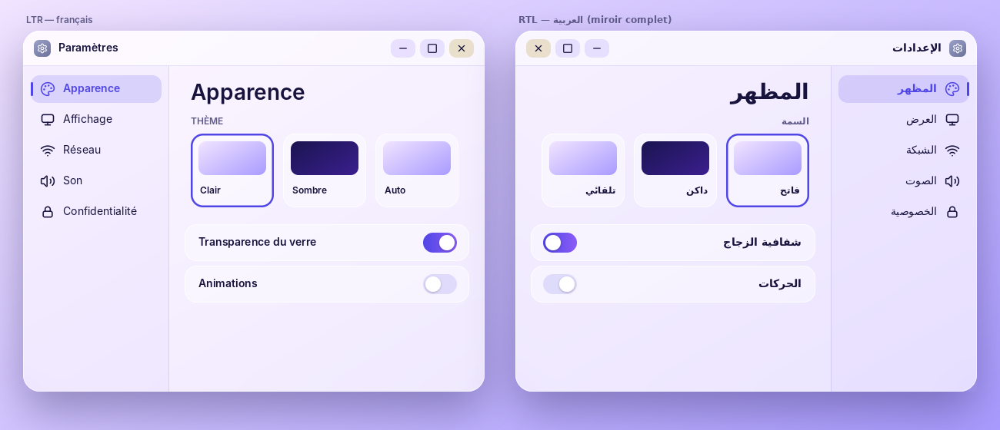
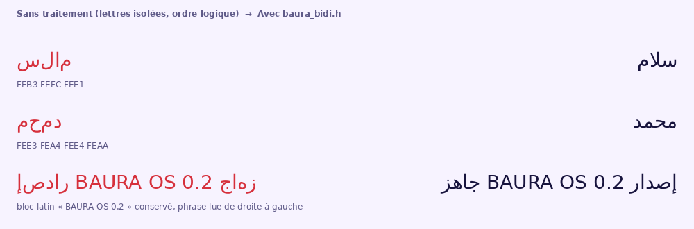
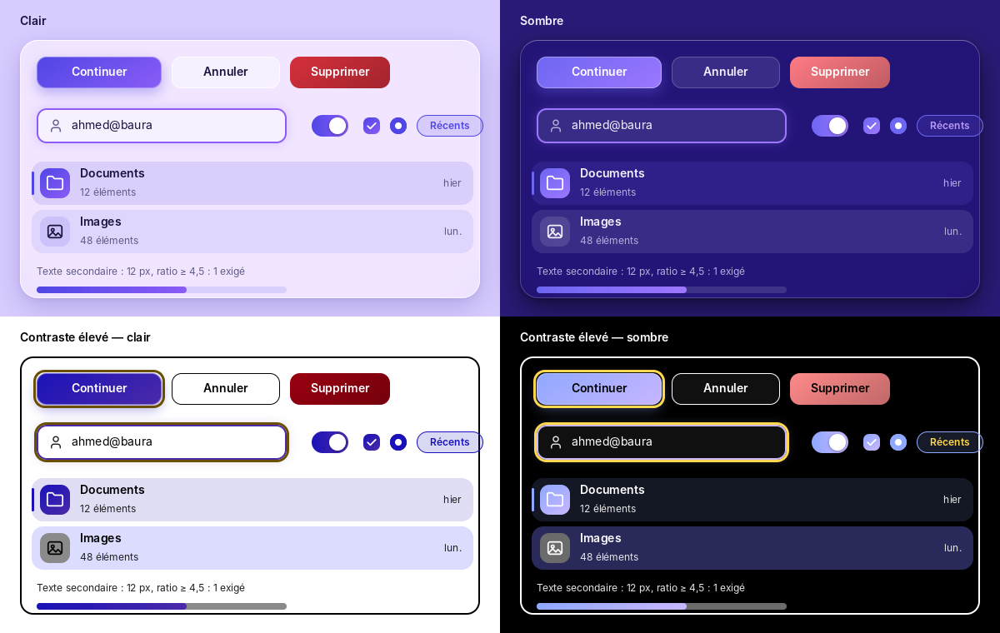
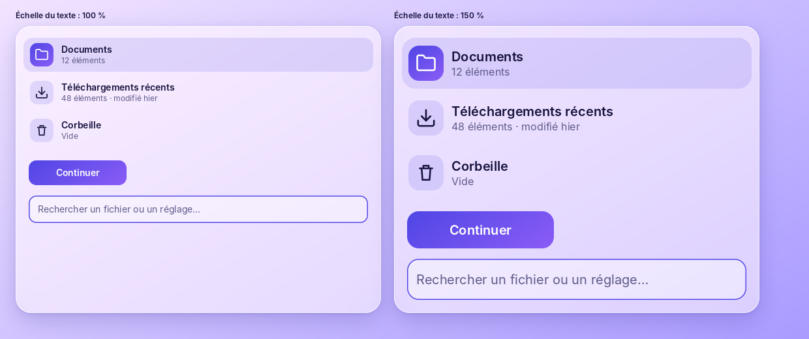
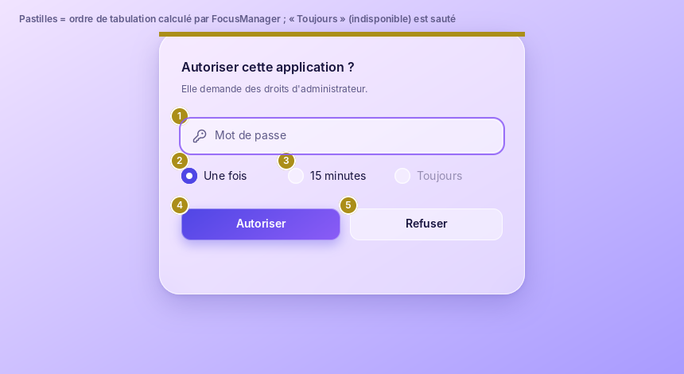

# 08 — Arabe / RTL et accessibilité

| Code | Rôle | Rendu |
|---|---|---|
| `code/baura_bidi.h` | jonction des lettres arabes, ligatures lam-alef, ordre bidirectionnel, parenthèses miroir, icônes directionnelles | `render/arabe-jonction.png` |
| `code/arabic_forms.h` | table des formes de présentation (GÉNÉRÉE depuis la base Unicode par `tools/gen_arabic_table.py`) | — |
| `code/baura_a11y.h` | contraste WCAG, thèmes contraste élevé, arbre d'accessibilité, gestionnaire de focus clavier | `render/a11y-*.png`, `render/arbre_a11y.txt`, `render/contraste.md` |
| `code/test_i18n_a11y.cpp` | 24 groupes de vérifications automatiques + tous les rendus | `./test_i18n_a11y` → « 08 : tests passent » |
| `../common/arabic.bgf` | atlas de glyphes arabes + latins (DejaVu Sans, 353 glyphes, 560 Kio) cuit avec `bake_font.py --ranges=…` | — |

## 1. Arabe et miroir RTL

À gauche le français (LTR), à droite la **même fenêtre** en arabe : barre latérale, icône de titre, boutons de fenêtre, cartes de thème, interrupteurs et texte passent de l'autre côté ; le texte s'aligne sur le bord de **départ** (droite). Tout est dessiné par la même fonction (`settings_demo`) avec `Ui::rtl = true`.

### Règles de miroir (à appliquer dans chaque composant)
| Élément | Règle |
|---|---|
| Disposition | `x' = largeur_conteneur − x − w` (déjà fourni : `Ui::mirror(rect, cw)`) |
| Texte | aligné sur le bord de départ ; `visual()` avant `Font::draw` ; `Font::measure` sur la chaîne visuelle |
| Icônes directionnelles | `rtl_icon(nom, rtl)` : flèches, chevrons, précédent/suivant, annuler/rétablir **sont échangés** ; horloge, coche, cloche, dossier, loupe **ne changent pas** |
| Interrupteur | « activé » = poignée côté **gauche** en RTL (le sens de lecture du mouvement s'inverse) |
| Curseur / progression | se remplit de droite à gauche |
| Ordre de focus (Tab) | ordre **logique** (identique), la flèche droite *recule* dans un groupe |
| Barre de fenêtre | boutons à gauche, titre à droite |
| Nombres, heures, adresses, noms de marque | restent dans l'ordre LTR (testé : « 12:30 », « BAURA OS 0.2 ») |
| Fichiers de traduction | UTF-8, ordre **logique** ; la mise en forme est faite à l'affichage |

### Mise en forme du texte arabe

- En rouge : caractères de base dessinés tels quels (lettres isolées, ordre inversé) — c'est ce que produirait `Font::draw` sans traitement.
- En noir : après `visual(texte, true)`. Vérifications automatiques : « سلام » → `FEB3 FEFC FEE1` (seen initiale, ligature lam-alef finale, meem isolée) ; « محمد » → initiale/médiane/médiane/finale ; « لا » → ligature isolée ; bloc latin conservé dans une phrase arabe ; parenthèses miroir ; heures non inversées.

### Limites assumées (et chemin d'évolution)
- **Pas de diacritiques** (fatha, damma… sont supprimés), pas de lettres persanes/ourdoues (pe, che, gaf), pas de tatweel, pas d'embeddings explicites : couvre l'interface courante de l'arabe standard, **pas l'algorithme UAX #9 complet**.
- La police de démonstration (DejaVu Sans) est **fonctionnelle mais pas belle** : en production, utiliser une police arabe de la famille d'Inter (par ex. *IBM Plex Sans Arabic* ou *Noto Sans Arabic*, licences libres — à vérifier avant d'embarquer) via le même outil `bake_font.py`.
- Les glyphes arabes sont cuits en **formes de présentation** (FE70–FEFC), donc le moteur n'a besoin d'aucun moteur OpenType (GSUB/GPOS) : simple, mais sans positionnement fin des marques.
- Pas de saisie arabe (disposition de clavier) ni de curseur bidirectionnel dans les champs : à ajouter à `baura_textedit.h` (placement du curseur par ordre visuel).
- Hébreu : même chaîne (classe R déjà reconnue), sans jonction.

## 2. Accessibilité
### 2.1 Contraste (WCAG 2.2) — calculé sur les jetons réels de la charte
Méthode : couleur composée sur le fond de verre, lui-même composé sur les deux extrêmes de fond d'écran (pire cas). Seuils : 4,5 : 1 pour le texte, 3 : 1 pour les composants graphiques.

| Thème | Paire | Ratio (pire fond) | Seuil | Résultat | Correctif proposé |
|---|---|---|---|---|---|
| clair | texte principal (fg) / fenêtre | 14.30 : 1 | 4.5 : 1 | OK | — |
| clair | texte discret (mut) / fenêtre | 5.18 : 1 | 4.5 : 1 | OK | — |
| clair | accent (liens, onglet actif) | 5.12 : 1 | 4.5 : 1 | OK | — |
| clair | or (badge Administrateur) | 2.59 : 1 | 4.5 : 1 | **insuffisant** | #7C660F (4.5 : 1) |
| clair | erreur (err) | 3.94 : 1 | 4.5 : 1 | **insuffisant** | #BC2A34 (4.9 : 1) |
| clair | succès (ok) | 3.54 : 1 | 4.5 : 1 | **insuffisant** | #197147 (4.9 : 1) |
| clair | bord de champ / fond | 1.04 : 1 | 3.0 : 1 | **insuffisant** | #858585 (3.0 : 1) |
| clair | indigo (b1) : composants, filets | 5.12 : 1 | 3.0 : 1 | OK | — |
| clair | texte blanc / bouton primaire (b1) | 6.29 : 1 | 4.5 : 1 | OK | — |
| clair | texte blanc / violet (b2) | 4.23 : 1 | 4.5 : 1 | **insuffisant** | — |
| clair | texte blanc / bouton danger (err) | 4.83 : 1 | 4.5 : 1 | OK | — |
| sombre | texte principal (fg) / fenêtre | 14.47 : 1 | 4.5 : 1 | OK | — |
| sombre | texte discret (mut) / fenêtre | 7.75 : 1 | 4.5 : 1 | OK | — |
| sombre | accent (liens, onglet actif) | 6.82 : 1 | 4.5 : 1 | OK | — |
| sombre | or (badge Administrateur) | 7.45 : 1 | 4.5 : 1 | OK | — |
| sombre | erreur (err) | 6.38 : 1 | 4.5 : 1 | OK | — |
| sombre | succès (ok) | 8.67 : 1 | 4.5 : 1 | OK | — |
| sombre | bord de champ / fond | 1.85 : 1 | 3.0 : 1 | **insuffisant** | #FFFFFF (16.0 : 1) |
| sombre | indigo (b1) : composants, filets | 3.68 : 1 | 3.0 : 1 | OK | — |
| sombre | texte blanc / bouton primaire (b1) | 4.35 : 1 | 4.5 : 1 | **insuffisant** | — |
| sombre | texte blanc / violet (b2) | 3.22 : 1 | 4.5 : 1 | **insuffisant** | — |
| sombre | texte blanc / bouton danger (err) | 2.51 : 1 | 4.5 : 1 | **insuffisant** | — |
| contraste élevé clair | fg / mut / focus sur fond | 21.0 / 16.5 / 7.7 : 1 | 7 : 1 (AAA) | OK | — |
| contraste élevé sombre | fg / mut / focus sur fond | 21.0 / 16.8 / 15.2 : 1 | 7 : 1 (AAA) | OK | — |

**Constats honnêtes** (9 paires sous le seuil) et correctifs proposés — à valider par le design :
| Problème | Correctif proposé |
|---|---|
| Or `#AB8E18` en texte sur clair : 2,6 : 1 | jeton `b4_text` clair = `#7C660F` (4,5 : 1) ; garder `#AB8E18` pour les aplats/icônes |
| `err` / `ok` en texte sur clair : 3,9 / 3,5 | `err_text` = `#BC2A34`, `ok_text` = `#197147` (≈ 4,9 : 1) |
| Bords de champ **quasi invisibles** (1,04 : 1 clair, 1,85 : 1 sombre) | clair : bord = indigo `#4F46E5` à **≥ 70 %** d'opacité (≈ 3 : 1) ; sombre : blanc à **≥ 35 %** (≈ 3,1 : 1) |
| Texte blanc sur violet `b2` (clair 4,2 : 1) et dans le dégradé du bouton primaire sombre (4,35 : 1) | bouton primaire sombre : dégradé `#5B4FE0 → #7C4DEB` (blanc 5,1–5,8 : 1) ; ou texte `#17133D` sur `b2` sombre (5,4 : 1) |
| Texte blanc sur `err` sombre (2,5 : 1) | texte `#17133D` sur `err` sombre (7,0 : 1) → c'est le rôle du nouveau jeton **`on_accent`** |

Le jeton `on_accent` (texte posé sur les aplats colorés) est **déjà ajouté** à `common/baura_theme_brand.h` (blanc par défaut) et utilisé par `button()`.

### 2.2 Thèmes à contraste élevé

`HC_DARK` / `HC_LIGHT` : **aucune transparence** (le verre devient opaque), bords pleins de 2 px, anneau de focus de 3 px jaune/or, ratios texte ≥ 7 : 1 (AAA) mesurés. Activation : réglage « Contraste élevé » **ou** détection automatique via le réglage système. Le même mécanisme coupe le flou (`blur = 0`) pour l'option « Réduire la transparence ».

### 2.3 Échelle du texte (100 % → 150 %)

Les hauteurs, rayons et icônes sont multipliés par `s` ; le texte choisit la taille cuite la plus proche (12/14/16/20/28 px) ; les libellés longs sont tronqués avec « … » (`ellipsize`) plutôt que débordés. **Règle de développement : aucune hauteur de composant en pixels fixes dans le code d'application — toujours `h = hauteur_base × échelle`.** Limite : 150 % de 14 px = 21 px → la police cuite la plus proche est 20 px ; ajouter 18 et 21 à `--sizes` si l'écart se voit.

### 2.4 Navigation au clavier

| Touche | Action |
|---|---|
| `Tab` / `Maj+Tab` | focus suivant / précédent (boucle ; éléments indisponibles ou masqués **sautés**) |
| Flèches | dans un groupe de radios, une liste d'onglets, un menu, une liste (en RTL, `→` recule) |
| `Entrée` / `Espace` | activer / cocher |
| `Échap` | fermer menu, panneau ou dialogue ; rend le focus à l'élément déclencheur |
| `Super` | ouvrir Démarrer ; `Super+S` recherche ; `Super+A` centre d'actions |
| `Alt+Tab` | changer de fenêtre ; `Alt+F4` fermer ; `Super+↑/↓` agrandir/réduire |
| `F6` | passer d'une zone à l'autre (barre, fenêtre, panneau) |
| `Maj+F10` | menu contextuel de l'élément focalisé |
Anneau de focus : 2 px `b2` à 85 %, décalé de 3 px (3 px jaune en contraste élevé) ; **toujours visible au clavier**, masqué seulement après un clic souris.

### 2.5 Arbre d'accessibilité
`Node{role, name, description, état, rect, enfants}` : modèle indépendant du dessin (sortie type du test) :
```
- boîte de dialogue « Autoriser cette application ? »
  - libellé « Elle demande des droits d'administrateur. »
  - champ de texte « Mot de passe » [focus]
  - groupe de radios « Durée »
    - radio « Une fois » [focus]
    - radio « 15 minutes » [focus]
    - radio « Toujours » [indisponible]
  - bouton « Refuser » [focus]
  - bouton « Autoriser » [focus]
```
`announce(node)` produit la phrase pour un lecteur d'écran : « Une fois, radio, activé ». Chaque composant de `04` doit **déclarer** son nœud (nom, rôle, état) en même temps qu'il se dessine ; le serveur d'affichage expose l'arbre à une future synthèse vocale.

### 2.6 Autres exigences (checklist)
- Mouvement : `Animator::reduce_motion` (fait en `05`) — respecter aussi à l'ouverture des fenêtres et au splash (`reduce_motion` déjà géré en `06`).
- Cibles tactiles/souris ≥ 32 × 32 px (boutons de fenêtre 32 × 24 : à porter à 32 × 32 en mode accessibilité).
- Ne jamais coder une information par la couleur seule (erreur = couleur **+ icône + texte**, comme dans l'écran de connexion de `07`).
- Clignotement < 3 Hz ; curseur de saisie fixe en `reduce_motion`.
- Zoom d'écran, loupe, filtres de couleur, sous-titres : hors périmètre ici, à planifier (voir roadmap P10).
