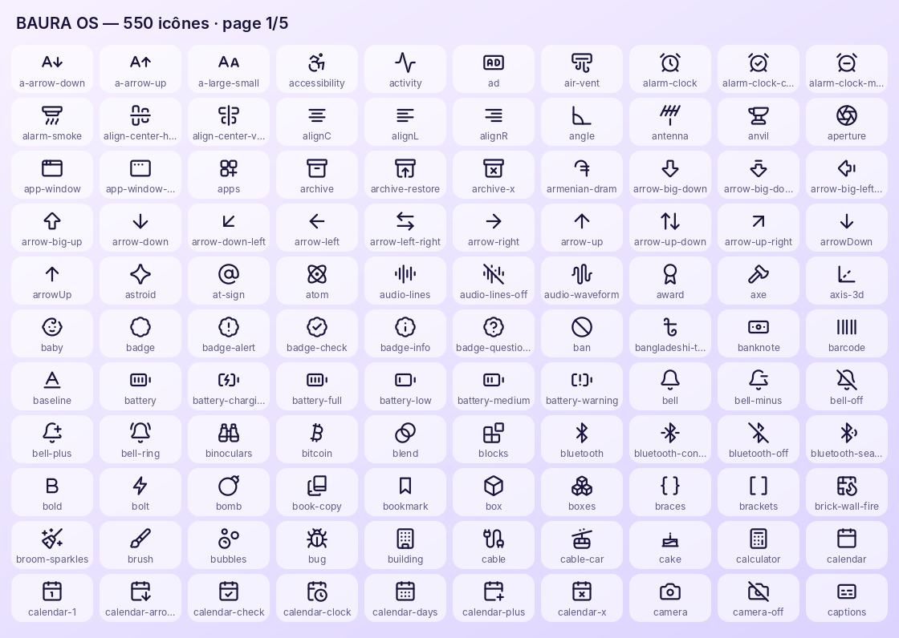

# 09 — Icônes : de 97 à 550

| Élément | Fichier |
|---|---|
| Jeu d'icônes embarqué (C++, GÉNÉRÉ) | `../common/icons_data.h` — à **ne pas** éditer à la main |
| Générateur | `../common/tools/gen_icons550.py` (lit les SVG Lucide + 97 icônes BAURA d'origine) |
| Version web (même jeu) | `../common/baura-icons.js` |
| Catalogue par catégorie + table d'alias | `CATALOGUE.md` · `catalogue.json` |
| Planches (550 icônes en 5 pages) | `render/icones_page1.png` … `icones_page5.png` |
| Générateur de planches | `code/icon_sheets.cpp` |
| Licence | `../common/LUCIDE-LICENSE.txt` (ISC) |



## Origine et licence
- **97 icônes BAURA** d'origine (barre de tâches, installateur, dossiers du système…) conservées telles quelles.
- **453 icônes Lucide** (licence **ISC**, libre d'usage commercial, notice à conserver — fournie). Les trajets SVG sont repris tels quels puis rendus par `BauraVec::Painter` (trait 1,9 px au lieu de 2 pour s'accorder au poids d'Inter).
- Régénérer : `git clone --depth 1 --filter=blob:none --sparse https://github.com/lucide-icons/lucide.git /tmp/luc/lucide && (cd /tmp/luc/lucide && git sparse-checkout set icons) && python3 common/tools/gen_icons550.py /tmp/luc/lucide/icons`

## Utilisation
```cpp
BauraVec::Painter p(renderer);
p.icon("folder", {x, y, 24, 24}, 0xFF17133D);          // contour 1,9 px
p.icon("shield", r, color, 2.4f);                      // trait plus épais (petits formats)
p.icon("system-search", r, color);                     // ancien nom Papirus : résolu par la table d'alias
```
- Taille conseillée : 16, 18, 20, 24 px (l'icône s'adapte à `min(w, h)`).
- Couleur : toujours un jeton de la charte (`fg`, `mut`, `accent`, `on_accent`).
- Icônes **directionnelles** : passer par `BauraText::rtl_icon()` en arabe (voir `08`).
- Recherche d'un nom : `CATALOGUE.md` (par catégorie) ou compiler avec `-DBAURA_ICON_DEBUG`.

## Coût et optimisation (à faire en P11 de la feuille de route)
Aujourd'hui chaque appel **parse le SVG** à chaque dessin et cherche le nom linéairement dans 550 entrées (suffisant pour l'aperçu, pas pour un bureau à 60 i/s). Plan : (1) résoudre le nom → index une fois ; (2) précalculer les polylignes de chaque icône au démarrage ; (3) mettre en cache une bitmap de couverture 8 bits par `(icône, taille)` — environ 550 × 24 × 24 = 316 Kio pour une taille, générable à la demande.

## Limites
- Les 453 icônes Lucide sont rendues **à trait** ; les glyphes « pleins » (ex. étoile remplie) ne sont pas fournis séparément.
- Pas d'icônes de **fichiers par type MIME** colorées (type « Papirus ») : `file-*` génériques seulement.
- Certains noms Lucide récents peuvent manquer (voir fin de `CATALOGUE.md`).
