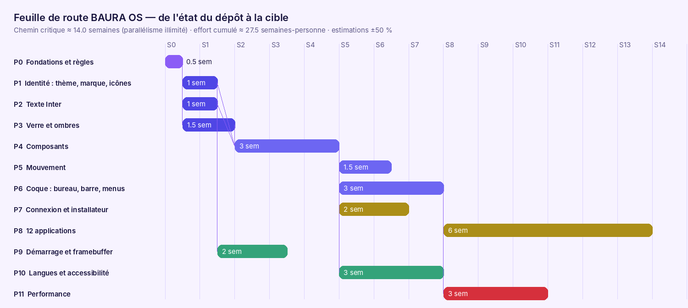

# 10 — Feuille de route : de l'état actuel du dépôt à la cible cohérente

> Ce document répond à : « comment passer de ce qui est dans `BAURA-OS` aujourd'hui à ce que montrent les rendus de `01`–`09`, sans rien casser ? ».
> Il n'y a **aucune action sur GitHub** dans ce plan : tout se fait dans votre copie locale ; vous décidez quand et quoi pousser.



## 0. Principes directeurs
1. **Additif d'abord, remplacement ensuite.** Les nouveaux en-têtes vivent dans un dossier neuf `GUI/UI_V2/` ; l'ancien code (`BGE`, `UI_FRAMEWORK`) reste fonctionnel jusqu'à ce qu'un écran entier soit migré. Un drapeau de compilation `BAURA_UI_V2` choisit le rendu.
2. **`make test-gui` reste vert à chaque phase** (le dépôt compile en `-Wall -Wextra -Werror`, les nouveaux en-têtes y satisfont déjà : vérifié sur 04–08).
3. **Une phase = un lot livrable** : fichiers touchés, tests ajoutés, critère d'acceptation mesurable (§2). On n'ouvre pas la phase suivante tant que le critère n'est pas atteint.
4. **Dessin pur + état externe** (voir `04`) : aucun composant ne cache d'état → rendu déterministe, testable par comparaison d'images.
5. **Mesurer avant d'optimiser** : voir §4 (le rendu actuel des maquettes est trop lent pour du temps réel — c'est le risque n° 1).
6. **Les rendus de ce dossier sont la référence visuelle** ; une phase est « finie » quand le rendu produit par le dépôt ressemble au rendu de référence (comparaison visuelle + tests).

## 1. Où en est-on ? (état de départ, commit `86642c0`)
| Domaine | Dépôt aujourd'hui | Cible | Écart |
|---|---|---|---|
| Identité | palette bleu/cyan, « B » pixelisé | charte indigo/violet/lavande/or, symbole vectoriel | thème + marque à remplacer |
| Rendu | rect arrondi crénelé, texte 5×7 majuscules | anti-crénelage SDF, Inter cuit | nouvelles couches au-dessus de `BGERenderer` |
| Verre | flou boîte, sans saturation/ombre | verre complet (ombre → flou → saturation → teinte → bord → reflet) | `effects_engine` à compléter |
| Composants | boutons/progression basiques | kit complet (04) | à intégrer |
| Mouvement | aucun | ressorts, ouverture/fermeture/réduction | compositeur animé + 2 getters |
| Coque | barre pleine largeur, widgets rudimentaires | barre flottante, Démarrer, recherche, centre d'actions | réécriture du rendu |
| Écrans système | connexion, installateur minimalistes | versions 07 | refonte du rendu, pas de la logique |
| Applications | aucune réelle (Files, Settings… en callbacks) | 12 modèles | à développer |
| Démarrage | pas de framebuffer, pas de splash réel | splash animé, GOP/Multiboot2 | boot à modifier |
| i18n / a11y | rien | RTL + arabe, contraste, clavier | à construire |
| Performance | non mesurée | 60 i/s sur le bureau | cache, rectangles sales |

## 2. Les phases
Effort = **semaines-personne, estimation grossière (±50 %)**. « Doc » = dossier de référence à suivre.

| Phase | Objectif | Doc | Effort | Dépend de | Risque |
|---|---|---|---|---|---|
| **P0** Fondations | dossier `GUI/UI_V2/`, règles de qualité, CI locale | 10 | 0,5 | — | faible |
| **P1** Identité | thème de la charte, marque vectorielle, 550 icônes | 01, 09 | 1 | P0 | faible |
| **P2** Texte | police Inter cuite, mesure/crénage, accents | 02 | 1 | P0 | moyen (chargement de la police au boot) |
| **P3** Verre & ombres | verre fidèle + ombres | 03 | 1,5 | P0 | moyen (coût CPU) |
| **P4** Composants | kit complet + saisie + focus | 04 | 3 | P1, P2, P3 | moyen |
| **P5** Mouvement | animations de fenêtre, ressorts | 05 | 1,5 | P4 | moyen (hit-test) |
| **P6** Coque | bureau **(barre coupée en deux par défaut ; flottante / pleine largeur en options)**, Démarrer, recherche, centre d'actions | 07 | 3 | P4 | élevé (visible partout) |
| **P7** Connexion & installateur | refonte des deux parcours | 07 | 2 | P4 | moyen |
| **P8** Applications | 12 modèles → vraies applications | 07 | 6 | P6 | élevé (dépend des services) |
| **P9** Démarrage | splash + framebuffer seL4/UEFI | 06 | 2 | P1, P2 | **élevé** (noyau, non testé sur cible) |
| **P10** Langues & accessibilité | RTL, arabe, contraste, clavier, lecteur d'écran | 08 | 3 | P4 | moyen |
| **P11** Performance | caches, rectangles sales, SIMD (dont cache d'icônes par taille) | 10 §4 | 3 | P6 | élevé |
| **P12** Icônes d'applications | intégrer `appicons`, étendre à ~200 rôles, passe d'illustrateur (variantes 16 px) | 11 | 2 | P1 | faible |
| **P13** Backend Rust | prefs persistantes (VFS), recherche réglages/fichiers, bascules rapides, énergie, sécurité/UAC, `no_std` | 12 | 5 | P6 | moyen (interfaces noyau) |
| **P14** Moniteur | source de mesures BAURA Core, commande de terminaison réelle, vue Démarrage | 13 | 1,5 | P13 | moyen |
| **P15** Mode natif | cadre natif par défaut, migration des 12 applications, curseurs, infobulles, glisser-déposer | 14 | 4 | P4, P8 | moyen |

Chemin critique ≈ **16 semaines** avec 3–4 personnes en parallèle ; **≈ 40 semaines-personne** au total (P0–P11 ≈ 27 ; P12–P15 ≈ 12,5). Avec une seule personne : ≈ 9–10 mois. À **recalibrer après P1** avec la vitesse réelle.

### P0 — Fondations (0,5 sem)
- Créer `GUI/UI_V2/` : copier `common/*.h` (hors `icons_data.h` si trop gros pour la revue : le générer à la compilation), `assets/inter.bgf`, `assets/mono.bgf`.
- Ajouter à `make test-gui` : `-IGUI/UI_V2`. Ajouter `GUI/UI_V2/tests/` (un test par doc).
- Règle de style : en-têtes C++17, **pas d'exceptions ni de RTTI** dans le code de dessin, aucune allocation dans la boucle de rendu (buffers réutilisés), pas de `std::map` dans les chemins chauds.
- **Sortie** : `make test-gui` vert avec un test vide `ui_v2_smoke`.
- Bloc Makefile type :
```make
UI_V2_INC = -IGUI/UI_V2
test-ui-v2:
	$(HOST_CXX) -std=c++17 -Wall -Wextra -Werror $(UI_V2_INC) -IGUI/BGE \
		-o $(BUILD_DIR)/ui_v2_test GUI/UI_V2/tests/ui_v2_test.cpp \
		GUI/BGE/renderer.cpp GUI/BGE/renderer_core.cpp GUI/BGE/effects_engine.cpp
	cd GUI/UI_V2/tests && $(BUILD_DIR)/ui_v2_test
test-gui: test-ui-v2   # ajouter la dépendance quand stable
```

### P1 — Identité (1 sem) · doc 01, 09
| Fichier du dépôt | Changement |
|---|---|
| `GUI/UI_FRAMEWORK/baura_theme.h` | **conserver** les noms (`BauraTheme::AccentBlue`…) mais les faire pointer vers les jetons de `baura_theme_brand.h` (alias) : le code existant change de couleur sans être réécrit |
| `GUI/UI_FRAMEWORK/baura_brand.h` | `draw_mark` / `draw_boot_splash` → `Painter::symbol` (marque vectorielle) |
| `GUI/UI_FRAMEWORK/papirus_icon_catalog.cpp` | résoudre les ids Papirus via la table d'alias de `icons_data.h` |
- **Tests** : `test_identity` ; pixel-test : le symbole 64 px a ses 4 couleurs aux positions attendues.
- **Acceptation** : toutes les surfaces existantes ont la nouvelle palette ; plus aucun « B » pixelisé ; la planche d'audit `00` rendue avec le thème clair + sombre.
- **Risque** : contraste du thème sombre (voir P10 : jetons à corriger).

### P2 — Texte (1 sem) · doc 02
- Embarquer `inter.bgf` (≈ 500 Kio) : tableau C généré (`xxd -i`) **ou** module GRUB `module2 /boot/inter.bgf` lu par la tâche GUI (préférable : pas de recompilation).
- `Font::load` au démarrage de `BauraGuiPlatform::initialize`. Repli : si le chargement échoue, garder `draw_text` 5×7 (le système reste utilisable).
- **Tests** : `test_text` (accents, crénage, `ellipsize`, mesure = dessin à 0,5 px près).
- **Acceptation** : « Paramètres », « Téléchargements » s'affichent avec accents et minuscules dans la barre et le menu.
- **Risque** : mémoire de la tâche GUI (+ ~0,5 Mio) ; vérifier la taille du tas disponible.

### P3 — Verre & ombres (1,5 sem) · doc 03
- Ajouter à `effects_engine` (ou utiliser `baura_glass.h` au-dessus) : ombre à deux couches, flou à ≈ 3 passes boîte, saturation ×1,9, teinte, bord 1 px, reflet haut.
- **Tests** : `test_glass` ; invariants (le bord reste dans le rect, pas d'écriture hors clip).
- **Acceptation** : le rendu de la barre et du menu Démarrer est visuellement identique à `07` (comparaison côte à côte).
- **Risque** : **coût** — un panneau de 600×540 coûte ≈ 57 ms sans cache (§4). Prévoir dès cette phase le **cache de fond flouté** (clé = zone + version du fond d'écran).

### P4 — Composants (3 sem) · doc 04
- Intégrer `baura_ui.h` + `baura_textedit.h` ; contrôleur d'événements par fenêtre (survol/focus/clic) qui utilise les `Rect` **retournés** par les fonctions de dessin.
- Remplacer, un par un, boutons/champs/listes de `baura_ui_toolkit.cpp` ; **ne pas changer** les signatures de `BAURA_UI_FRAMEWORK.h`.
- Ajouter : liste défilante (virtualisée), menu déroulant (champ + menu), saisie multi-ligne.
- **Tests** : `test_components` (images), `test_textedit` (logique), + tests d'événements (clic dans la zone retournée → callback).
- **Acceptation** : un formulaire (champ, case, bascule, boutons) est utilisable à la souris **et** au clavier (Tab/Entrée/Échap).

### P5 — Mouvement (1,5 sem) · doc 05
- Appliquer le patch de 2 getters (`git apply` en local) ; intégrer `baura_wm_motion.h` dans la boucle de rendu.
- **Changer les constantes de hit-test** du `BGEWindowManager` : barre 40 → 46 px, contrôles 84 px → 3×32 + espaces, barre des tâches 58 px → barre flottante (zone = `Rect` retourné par `taskbar()`).
- **Tests** : `test_motion` + test de hit-test : cliquer au centre de chaque bouton dessiné déclenche l'action attendue.
- **Acceptation** : ouverture/fermeture/réduction animées ; `reduce_motion` coupe tout ; aucun clic « à côté » d'un bouton.

### P6 — Coque (3 sem) · doc 07
| Fichier du dépôt | Changement |
|---|---|
| `GUI/UI_FRAMEWORK/baura_hybrid_taskbar.cpp` | `draw_taskbar`, `draw_top_widgets`, `draw_start_panel`, `draw_search_panel`, `draw_notifications_panel` → `BauraShell::*` (voir `07` §3) |
| `GUI/DESKTOP/baura_desktop.cpp` | fond (`wallpaper`), ordre de rendu, fenêtres avec le nouveau cadre |
| `GUI/UI_FRAMEWORK/system_bubble.cpp`, `ui_extensions.cpp` | bulle et graphique de charge |
- Ordre conseillé : fond → **barre coupée en deux (défaut)** → zone d'état / widgets → Démarrer → recherche → centre d'actions ; les dispositions **flottante** et **pleine largeur** viennent ensuite comme options (`baura-prefs: layout`).
- **Tests** : `gui_render_test` existant (clic sur Démarrer, recherche, notifications) **doit rester vert** ; ajouter un test de zones cliquables.
- **Acceptation** : le bureau rendu par le dépôt ressemble à `bureau_clair/sombre`, et les actions existantes (`emit_action`) fonctionnent.

### P7 — Connexion & installateur (2 sem) · doc 07
- `login_screen.cpp` : carte, horloge, œil du mot de passe, message d'erreur avec icône (le callback `set_message` existe).
- `installer_gui.cpp` : rail d'étapes + contenus ; **la logique `BauraInstallStage` ne change pas**, seulement le rendu ; ajouter les écrans langue/clavier (choix passés au backend).
- **UAC** : nouveau dialogue modal ; dépend d'un **service d'élévation** (hors périmètre GUI : à spécifier avec le noyau/BAURA Core).
- **Acceptation** : parcours complet de l'installateur sur la maquette ; mauvais mot de passe → erreur lisible.

### P8 — Applications (6 sem) · doc 07
Chaque application = (1) un gabarit de `baura_apps.h` (visuel), (2) un **service** derrière (fichiers, réseau, son…). L'ordre suit la dépendance aux services, pas le visuel :
1. **Paramètres** (thème, accents, effets — valide tout le kit) · 2. **Fichiers** (a besoin du serveur de fichiers) · 3. **Terminal** (VT100 minimal) · 4. **Gestionnaire des tâches** (compteurs BAURA Core) · 5. **Réseau**, **Son**, **Énergie** (pilotes) · 6. **Mise à jour**, **Sécurité** · 7. **Boutique**, **HOUB**, **BMedia** (les plus lourds : moteur web, codecs, catalogue).
- **Acceptation par application** : fonctionne sans la moindre donnée factice, a ses états vide/erreur/chargement, passe le test clavier de P10.
- **Risque** : HOUB et BMedia sont de **vrais projets** (moteur de rendu web, codecs) : le gabarit visuel n'en est que l'enveloppe. À traiter comme des chantiers séparés.

### P9 — Démarrage & framebuffer (2 sem) · doc 06
- GRUB `gfxmode`/`gfxpayload=keep`, en-tête Multiboot2, `find_framebuffer`, mappage seL4 (**à valider sur la version de seL4 épinglée** — non compilé ici), splash animé.
- **Acceptation** : QEMU 1280×720 : splash sans décalage de lignes, RGB/BGR corrects, repli série si pas de framebuffer ; boot ≤ +50 ms.
- **Risque n° 1 de la feuille de route** : tout ce qui touche l'espace noyau/boot se teste sur QEMU **puis** sur du matériel réel.

### P10 — Langues & accessibilité (3 sem) · doc 08
- Fichiers de traduction UTF-8 (logiques), `visual()` à l'affichage, miroir RTL de chaque composant, police arabe de production.
- Corriger les jetons sous le seuil WCAG (table de `08` §2.1), ajouter `on_accent`, thèmes contraste élevé, option « réduire la transparence ».
- Arbre d'accessibilité : chaque composant déclare son nœud ; navigation clavier complète ; échelle de texte 100–150 %.
- **Acceptation** : l'application Paramètres est entièrement utilisable en arabe (RTL) et au clavier seul ; 100 % des paires de jetons ≥ seuils WCAG.

### P11 — Performance (3 sem) · §4
Voir ci-dessous ; **un premier lot (cache du fond d'écran, cache d'icônes) doit être fait dès P3/P6**, pas à la fin.

## 3. Correspondance fichier du dépôt → phases
| Fichier / dossier du dépôt | Phases |
|---|---|
| `GUI/UI_FRAMEWORK/baura_theme.h`, `baura_brand.h` | P1 |
| `GUI/UI_FRAMEWORK/papirus_icon_catalog.*` | P1 |
| `GUI/BGE/renderer*.cpp` (texte 5×7, icônes primitives, rect crénelé) | P1–P2 (conservés comme repli), retirés en fin de P6 |
| `GUI/BGE/effects_engine.*` | P3, P11 |
| `GUI/UI_FRAMEWORK/baura_ui_toolkit.cpp`, `ui_extensions.*` | P4, P6 |
| `GUI/BGE/window_manager.*` | P5 (constantes, 2 getters), P6 |
| `GUI/UI_FRAMEWORK/baura_hybrid_taskbar.*`, `GUI/DESKTOP/*` | P6 |
| `GUI/UI_FRAMEWORK/system_bubble.*` | P6 |
| `GUI/LOGIN_SCREEN/*`, `BOOT/INSTALLER/*` | P7 |
| `GUI/PLATFORM/*` | P2 (chargement police), P9 (framebuffer) |
| `BOOT/SEL4/grub.cfg`, `initial_task.c` | P9 |
| `Makefile` | P0 (+ chaque phase : un test) |

## 4. Performance : mesures et plan (P11)
Mesures **réelles** sur la machine de rédaction (hôte, `-O2`, 2 cœurs, sans cache, sans SIMD) — rendu 1280×720 :

| Élément | Temps |
|---|---|
| fond d'écran (dégradé + halo + symbole) | 78 ms |
| barre flottante (verre) | 11 ms |
| zone d'état (verre) | 5 ms |
| menu Démarrer 600×540 (verre) | 57 ms |
| fenêtre Fichiers 760×470 (verre + contenu + icônes) | 87 ms |
| **bureau complet** | **≈ 186 ms (≈ 5 images/s)** |

**Conclusion : en l'état, ce code est une référence visuelle, pas un moteur temps réel.** Objectif : ≤ 16 ms par image inactive-avec-mouvement local (60 i/s), et ≈ 0 ms au repos. Plan, par gain décroissant :
1. **Couche statique mise en cache** : fond d'écran dessiné **une fois** (−78 ms) ; redessiné seulement au changement de thème/résolution.
2. **Rectangles sales** (`damage`) : ne redessiner que ce qui change (curseur, survol, animation d'une fenêtre) ; le compositeur existant (`COMPOSITOR/`) a déjà la notion de z-order à étendre.
3. **Cache du fond flouté** derrière chaque surface de verre (clé : zone + version du fond) ; **flou en quart de résolution** puis agrandissement (−75 % de pixels) ; rayon variable selon la taille.
4. **Cache d'icônes** : polylignes précalculées + bitmaps 8 bits par (icône, taille) (voir `09`).
5. **Cache de texte** : lignes statiques (titres) dans des bitmaps.
6. **Optimisation CPU** : boucles par ligne avec écriture alpha en bloc, SIMD (SSE2 minimum sur x86_64), un seul passage de clip.
7. En dernier : GPU (hors périmètre ; `gpu_accel_3d` est un rasterizer logiciel).

**Critère** : un banc `perf_ui_v2` (comme celui utilisé ici) exécuté par `make bench-gui`, avec budget par élément et échec si dépassé de > 25 %.

## 5. Qualité continue
| Contrôle | Quand |
|---|---|
| `make test-gui` (dépôt) + tests `UI_V2` | à chaque commit |
| comparaison d'images (rendus de référence de ce dossier, tolérance par pixel) | à chaque phase d'écran |
| `-Wall -Wextra -Werror` | toujours |
| `-DBAURA_ICON_DEBUG` (noms d'icônes introuvables) | tests |
| budget de performance | P11 puis à chaque commit |
| revue accessibilité : contraste, clavier, RTL | P10 puis à chaque nouvel écran |

## 6. Ce que cette feuille de route ne couvre pas
Pilotes (réseau, audio, USB HID, GPU), multi-écrans et haute densité (HiDPI), moteur web de HOUB, codecs de BMedia, service d'élévation (UAC), gestion de comptes, synthèse vocale, saisie tactile, mise à jour atomique du système. Ils conditionnent P8 mais relèvent de la feuille de route du noyau (`BAURA OS — Roadmap du noyau et du système de boot.md`).

## 7. Utiliser ce dossier comme référence locale
1. Copier tout `baura-os-docs/` dans votre dossier de référence (les `render/*.png` sont déjà inclus).
2. `BAURA_OS_REPO=/chemin/vers/BAURA-OS ./build_all.sh` régénère **tous** les rendus et exécute **tous** les tests contre votre dépôt (sans le modifier). `./build_all.sh 06 08` pour certains documents.
3. Pour chaque phase : lire le README du dossier correspondant, copier le code dans `GUI/UI_V2/` (en local), faire passer ses tests, comparer au rendu de référence.

## 8. Ajouts (docs 11–14)
- **P12 · Icônes (11)** : `app_tile()` passe déjà par les icônes BAURA ; reste la passe d'illustrateur et l'extension des rôles.
- **P13 · Backend (12)** : le gros risque est l'**interface avec BAURA Core** (compteurs, signaux, élévation) : à spécifier côté noyau avant d'écrire les sources réelles. Les crates `VFS`, `SECURITY`, `POWER_MANAGER` existants sont à raccorder, pas à réécrire.
- **P14 · Moniteur (13)** dépend de P13 ; il est **utilisable dès maintenant** avec la source synthétique ou `/proc` (hôte).
- **P15 · Natif (14)** : à lancer **tôt sur un écran pilote** (Fichiers) pour valider la direction avec de vrais utilisateurs avant de migrer les 11 autres applications.
