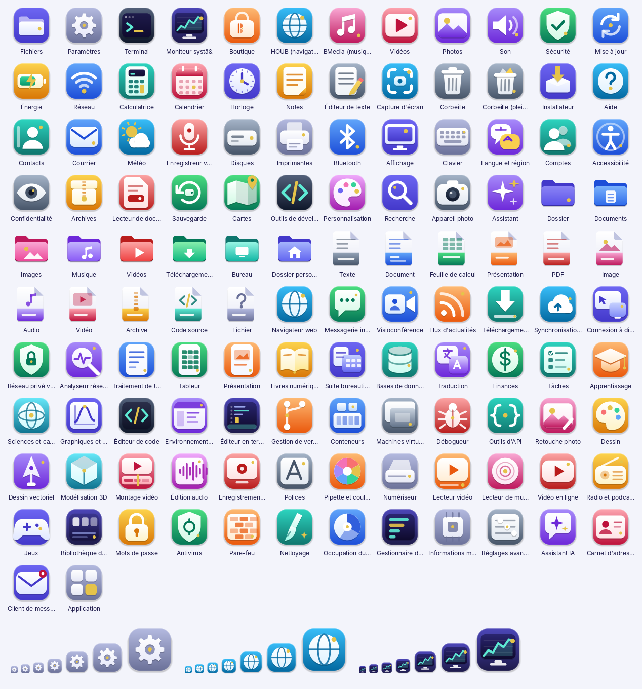
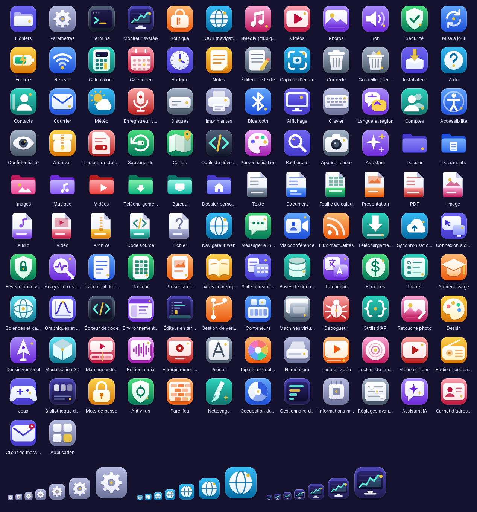

# 11 — Icônes d'applications BAURA (système **et** applications existantes)




**Objectif :** que *toutes* les icônes d'applications du bureau (Fichiers, Paramètres… mais aussi navigateur, lecteur PDF, éditeur de code, jeux, etc.) aient **la même langue visuelle**, dessinée pour BAURA OS. Les thèmes plats comme Papirus ont montré qu'un jeu cohérent change tout ; on s'en inspire pour le *principe* (tuile colorée + pictogramme simple, couleur = famille d'usage), on ne reprend **aucun** dessin.

| Élément | Fichier |
|---|---|
| Bibliothèque de dessin (DSL 64×64 : tuiles, dégradés, ombre, point doré) | `tools/icon_lib.py` |
| Icônes système (46) · dossiers (8) + types de fichiers (11) · icônes de **rôle** pour applis existantes (~57) | `tools/icons_system.py` · `tools/icons_files.py` · `tools/icons_functional.py` |
| Table « application connue → icône de rôle » (368 identifiants) + repli par catégorie `.desktop` | `tools/known_apps.py` |
| Générateur : C++ · SVG · Rust · catalogue | `tools/gen_appicons.py` → `../common/appicons_data.h`, `svg/*.svg`, `catalogue_appicons.json`, `../12-BACKEND/…/baura-icons/src/data.rs` |
| Rendu C++ (tailles 16 → 128, ombre, détails supprimés en petit) | `../common/baura_appicons.h` |
| Test + planches | `code/test_appicons.cpp` → `render/appicons_clair.png`, `appicons_sombre.png` |

## 1. Langage visuel (les règles que tout nouvel icône suit)
1. **Grille 64×64**, tuile à coins arrondis (56×56, rayon 15) en **dégradé vertical** — la couleur indique la *famille* : indigo = système/fichiers, bleu = réseau/mise à jour, vert = sécurité/finance, orange = achats/présentation, rose = médias, rouge = alerte/PDF, gris = matériel/réglages, nuit = outils de développement.
2. **Pictogramme blanc à deux tons** (blanc plein + blanc 60 %), formes **pleines** (pas de trait fin) pour rester lisible à 16 px ; traits seulement pour l'accessoire (ondes, lignes de texte).
3. **Ombre portée douce** sous le motif principal (désactivée sous 28 px).
4. **Un petit point doré** dans chaque icône : clin d'œil au symbole BAURA, et signature immédiate d'une icône « maison ».
5. **Dossiers et types de fichiers** sont *sans tuile* (silhouette propre) ; les dossiers ont un emblème (documents, images, musique…).
6. **Niveau de détail** : chaque élément porte `min_px` ; sous cette taille il n'est pas dessiné (ex. les lignes d'une grille).

## 2. Applications existantes : icône de **rôle**, pas de logo
Le système ne reproduit **pas** les logos de marques tierces (Firefox, VLC, GIMP… sont des marques déposées et les copier créerait un mélange incohérent). Une application connue reçoit l'icône de **ce qu'elle fait** : `firefox`, `chromium`, `brave` → *Navigateur web* ; `vlc`, `mpv` → *Lecteur vidéo* ; `gimp`, `krita` → *Retouche photo* ; `code`, `sublime-text` → *Éditeur de code*. Le **nom** de l'application reste affiché sous l'icône : on la reconnaît, et la grille est homogène.
Ordre de résolution (`baura_appicons.h::find`, `baura-icons::resolve`) :
1. identifiant **exact** (`files`) → 2. **alias** freedesktop/Papirus (`org.gnome.Nautilus`, `application-pdf`) → 3. **application connue** (`firefox`) → 4. **catégorie** du fichier `.desktop` (`Game;` → *Jeux*) → 5. icône **Application** générique.
Les éditeurs d'applications peuvent fournir leur propre icône : le réglage **Paramètres › Bureau › Style des icônes › « Icônes d'origine »** (`baura_icons_enabled() = false`) les affiche telles quelles.

## 3. Catalogue (122 icônes)
| Catégorie | Nb | Identifiants |
|---|---|---|
| accessoires | 6 | `calculator`, `clock`, `text-editor`, `screenshot`, `weather`, `archive` |
| bureautique | 17 | `calendar`, `notes`, `contacts`, `pdf-viewer`, `writer`, `spreadsheet`, `presentation`, `ebook`, `office-suite`, `database`, `translator`, `finance`, `tasks`, `education`, `science`, `graph`, `contacts-card` |
| création | 10 | `photo-editor`, `paint`, `vector`, `3d`, `video-editor`, `audio-editor`, `screen-recorder`, `font-manager`, `color-picker`, `scanner` |
| dossiers | 8 | `folder`, `folder-documents`, `folder-pictures`, `folder-music`, `folder-videos`, `folder-downloads`, `folder-desktop`, `folder-home` |
| développement | 9 | `devtools`, `code-editor`, `ide`, `terminal-editor`, `git`, `containers`, `virtual-machine`, `debugger`, `api-tools` |
| internet | 13 | `houb`, `mail`, `maps`, `browser`, `chat`, `video-call`, `rss`, `torrent`, `cloud`, `remote`, `vpn`, `network-tools`, `mail-client` |
| jeux | 2 | `game`, `game-launcher` |
| multimédia | 9 | `media`, `video`, `photos`, `recorder`, `camera`, `video-player`, `music-player`, `streaming`, `radio` |
| système | 34 | `files`, `settings`, `terminal`, `monitor`, `store`, `sound`, `security`, `update`, `power`, `network`, `trash`, `trash-full`, `installer`, `help`, `disks`, `printer`, `bluetooth`, `display`, `keyboard`, `language`, `accounts`, `accessibility`, `privacy`, `backup`, `personalization`, `search`, `personal-assistant`, `cleaner`, `disk-usage`, `process-manager`, `hardware-info`, `system-tweaks`, `ai-assistant`, `app-generic` |
| sécurité | 3 | `passwords`, `antivirus`, `firewall` |
| types de fichiers | 11 | `file-text`, `file-doc`, `file-sheet`, `file-slides`, `file-pdf`, `file-image`, `file-audio`, `file-video`, `file-archive`, `file-code`, `file-unknown` |

## 4. Utiliser / ajouter
```cpp
#include "baura_appicons.h"
BauraVec::appicons::draw(painter, "firefox", {x, y, 48, 48});          // résolu → « browser »
BauraVec::appicons::Style s; s.shadow = false;                          // listes denses
BauraVec::appicons::draw(painter, "folder-documents", r, s);            // dossier sans tuile
```
`app_tile()` de `baura_ui.h` passe désormais par ce rendu (tous les écrans de `07` l'utilisent) et retombe sur l'ancien dessin (tuile + glyphe de trait) si l'icône est inconnue ou si le style « d'origine » est actif.
**Ajouter une icône :** 1) écrire `icon('mon-id', 'Nom', 'catégorie', 'teal', [...éléments...], ['alias-1'])` dans `tools/icons_functional.py` ; 2) `python3 tools/gen_appicons.py` ; 3) lier les applications dans `known_apps.py` ; 4) `./build_all.sh 11 12` (le test Rust vérifie que toute cible de table existe).

## 5. Licence, origine, limites
- **Dessins 100 % originaux** (trajets écrits à la main dans les fichiers `tools/icons_*.py`). Aucun fichier Papirus n'est copié ni retracé : Papirus est sous **GPL-3** ; on s'en inspire pour le *style*, ce qui n'est pas protégé, mais on ne dérive pas de ses fichiers.
- Aucun logo de marque tiers. Si vous voulez les logos officiels (ex. pour une boutique), ce sont des ressources **fournies par l'éditeur** avec son paquet (option « Icônes d'origine »).
- Qualité : dessins de **première passe** — cohérents mais perfectibles ; un illustrateur devrait repasser dessus (alignement optique, variantes 16 px dédiées).
- 122 icônes couvrent les rôles courants ; les applications très spécialisées retombent sur *Application*. Ajouter ~30 rôles (CAO, DAW, SIG…) est une tâche de quelques heures chacune.
- Coût de rendu : les chemins sont mis en cache (parsing une fois) mais remplis par balayage à chaque dessin ; le cache d'icônes pré-rendues par taille est prévu en P11.
