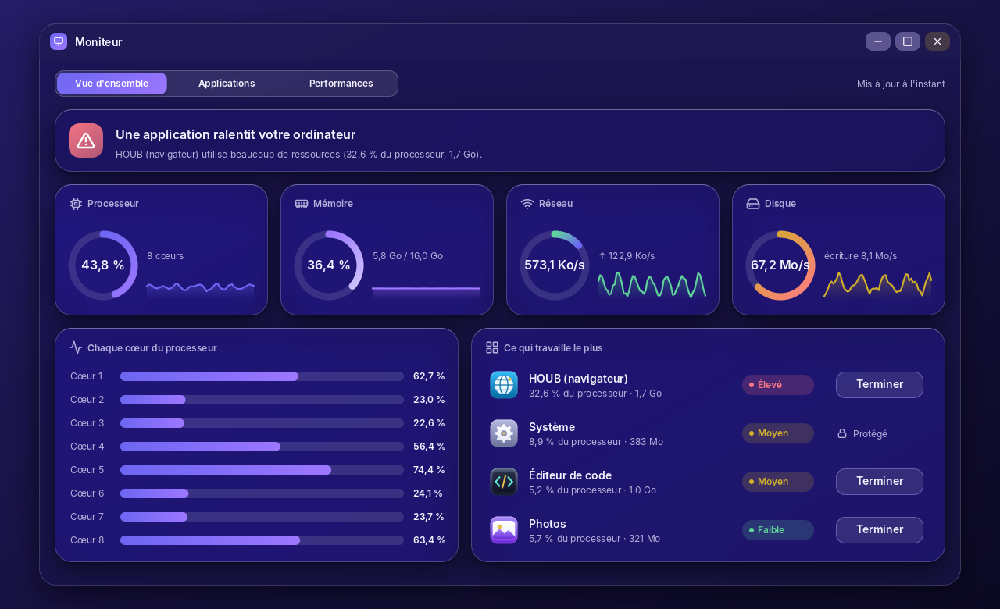

# 13 — Le Moniteur : un gestionnaire des tâches pour tout le monde

Le Moniteur remplace le « Gestionnaire des tâches » du document 07. Idée : **un gestionnaire des tâches répond à deux questions seulement** — *« pourquoi mon ordinateur ralentit ? »* et *« comment l'arrêter ? »* — alors que les outils classiques montrent des dizaines de colonnes. Le Moniteur répond d'abord **en une phrase**, puis donne le détail à la demande.

| Élément | Fichier |
|---|---|
| Vues (carte, jauge, courbe, ligne d'application, verdict) | `code/baura_monitor_view.h` |
| Rendus + tests (alimentés par le **backend Rust**, `../12-BACKEND`) | `code/test_monitor.cpp` |
| Rendus | `render/moniteur_*.png` |

## 1. Les trois pages
| Page | Ce qu'on y voit | Rendu |
|---|---|---|
| **Vue d'ensemble** | **Verdict** en une phrase (« Tout va bien » / « Une application ralentit votre ordinateur » / « La mémoire est presque pleine ») · 4 cartes (processeur, mémoire, réseau, disque : jauge + courbe) · chaque cœur · « Ce qui travaille le plus » (4 applications, avec Terminer) | `moniteur_vue-ensemble_clair/sombre` |
| **Applications** | Liste **triée par impact** (les plus gourmandes d'abord), processeur, mémoire, pastille d'impact, bouton **Terminer** ; « Système » est **protégé** (cadenas) | `moniteur_applications_clair/sombre` |
| **Performances** | 4 grandes courbes sur 30 s + température, batterie, échange (swap), cœurs | `moniteur_performances_clair/sombre` |
| **Terminer** | confirmation explicite : conséquence (« 3 processus seront arrêtés et 383 Mo libérés »), bouton Danger | `moniteur_terminer_sombre` |

## 2. Règles de conception (ce qui le rend « simple »)
1. **Applications, pas processus.** Les processus d'une même application (navigateur + ses 2 moteurs de rendu) sont **regroupés** (`group_processes`). On arrête *HOUB*, pas « houb-renderer ».
2. **Impact en trois mots** : *Faible / Moyen / Élevé* (seuils : élevé ≥ 25 % du processeur ou ≥ 15 % de la mémoire ; moyen ≥ 8 % ou ≥ 5 %). La couleur double toujours le texte (pas de rouge seul — voir `08`).
3. **Un seul verbe : « Terminer ».** Pas d'arbre, de priorités ni d'affinités au premier niveau ; ces options iront dans un menu « Plus » plus tard.
4. **On prévient avant de perdre du travail** : la confirmation dit ce qui sera arrêté et libéré.
5. **Ce qui est vital est protégé** : « Système » n'a pas de bouton (`Protected` côté Rust).
6. **Chiffres lisibles** : « 1,7 Go », « 2,5 Mo/s », virgule française ; jamais d'octets bruts.
7. Icônes d'applications = celles de `11` (même tuile partout).

## 3. D'où viennent les données
`BauraSvc::Services` (`12-BACKEND/include/baura_services.hpp`) : `tick(now_ms)`, `snapshot()`, `cores()`, `history(kind)`, `groups()`, `terminate(name)`. Source = `Synthetic` (déterministe : les rendus sont reproductibles) ; `Services(true)` utilise `/proc` sur Linux. Le **test** (`test_monitor.cpp`) vérifie le tri par impact, le formatage, et qu'après `terminate`, l'application disparaît bien de la liste.

## 4. Limites
- Données **synthétiques** dans les rendus ; une source réelle BAURA Core (compteurs par tâche seL4) reste à écrire.
- « Terminer » agit sur le **modèle** ; l'envoi du signal au noyau est à spécifier.
- Pas encore : colonnes GPU/disque par application, recherche dans la liste, tri manuel, vue « Démarrage » (applications lancées au démarrage), mini-widget de barre des tâches.
- Rendu statique : le défilement, le survol et le focus clavier utilisent les composants de `04` mais ne sont pas animés ici.
