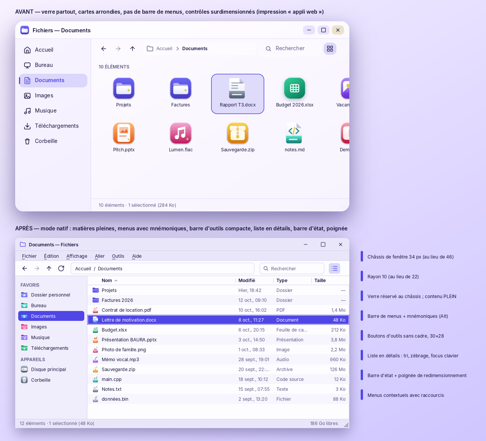

# 14 — Faire « OS » : sortir de l'impression d'application web

Retour de la relecture : *« ça donne toujours l'impression d'être sur une appli web »*. C'est juste, et ça s'explique : les 12 modèles de `07` suivent les habitudes du **web** (cartes arrondies à 22 px, verre partout, grosses marges, boutons-pilules, aucune barre de menus/d'état). Ce document identifie les causes, fixe des règles, et fournit les composants natifs.

| Élément | Fichier |
|---|---|
| Composants natifs (châssis, barre de menus, outils, barre latérale, liste en détails, barre d'état, poignée, menu contextuel) + **densité** | `code/baura_native.h` |
| Rendus avant/après + variantes claire/sombre + test | `code/test_native.cpp` → `render/natif_*.png` |

## 1. Diagnostic : ce qui sonne « web »
| Symptôme | Pourquoi ça fait web | Règle native |
|---|---|---|
| Rayons 18–22 px, cartes dans des cartes | les composants web sont des boîtes empilées | rayon de fenêtre **10**, contrôles **7**, pas de carte autour du contenu |
| Verre translucide **dans** la fenêtre | le flou est un effet de décor ; un contenu doit être lisible et stable | **verre réservé au châssis** (barre des tâches, Démarrer, menus, bulles) ; contenu sur **matière pleine** |
| Barre de titre 46 px, boutons-pilules | proportions de page web | barre de titre **34 px**, boutons de fenêtre pleine hauteur |
| Pas de barre de menus | une page n'a pas de menus | **barre de menus** avec mnémoniques (Alt+lettre soulignée) |
| Grandes icônes-tuiles pour des fichiers | style « galerie » | **liste en détails** par défaut (nom, date, type, taille ; tri, zébrage, focus) ; la grille reste un mode d'affichage |
| Boutons à cadre partout | formulaires web | barre d'outils : boutons **sans cadre** (cadre au survol) |
| Aucune barre d'état, aucune poignée | rien n'indique la fenêtre comme objet | **barre d'état** + **poignée** de redimensionnement ; curseurs (`Cursor::ResizeNWSE`…) |
| Marges de 20–32 px | confort tactile | **densité compacte** (ligne 26 px, barre d'outils 40 px) par défaut ; *Confortable* en option |
| Menus/clics sans raccourcis visibles | | menus avec **raccourcis alignés à droite**, éléments désactivés, séparateurs |

## 2. Densité (Paramètres › Bureau › Densité)
| Mesure | Compacte (défaut) | Confortable |
|---|---|---|
| Barre de titre | 34 | 40 |
| Barre de menus / d'outils | 26 / 40 | 30 / 48 |
| Ligne de liste / en-tête / barre d'état | 26 / 24 / 24 | 36 / 30 / 28 |
| Rayon fenêtre / contrôle | 10 / 7 | 12 / 9 |
Choix enregistré dans `baura-prefs` (`density`). Les cibles tactiles restent ≥ 24 px en compact (voir `08` pour 44 px en tactile).

## 3. Ce qui reste « verre » (et pourquoi)
La **personnalité** BAURA est conservée là où elle ne gêne pas la lecture : barre des tâches coupée en deux, Démarrer, recherche, centre d'actions, menus contextuels, bulles. C'est le « châssis » du bureau ; les fenêtres d'applications, elles, ont l'allure d'un outil de travail.

## 4. Mettre en œuvre
1. Appliquer `BauraNative::window()` comme **cadre par défaut** (le cadre verre de `07` devient un thème « Doux » optionnel) ; `05-MOUVEMENT` : constantes de barre à 34.
2. Migrer les 12 applications par famille : **Fichiers** (fait ici), puis Paramètres (barre latérale native), Terminal, Boutique, etc. — chacune gagne menu + barre d'état.
3. Composants à ajouter ensuite : barre de défilement **toujours visible** au survol, info-bulles retardées (500 ms), sélection par rectangle élastique, glisser-déposer avec aperçu, curseurs réels dans le compositeur, menus de la barre qui s'enchaînent au survol.
4. Mouvement : durées plus courtes (120–160 ms) pour les fenêtres natives ; pas de rebond (le ressort de `05` garde son rebond *discret* sur Démarrer seulement).

## 5. Limites
- Seule **Fichiers** est refaite en natif ici (rendu statique). Les 11 autres gardent leur forme de `07` jusqu'à migration.
- Les curseurs sont **définis** (`Cursor`) mais pas dessinés : le compositeur doit les afficher.
- Aucun test d'utilisabilité réel : ce sont des règles tirées des conventions des bureaux établis, à valider avec de vrais utilisateurs.
